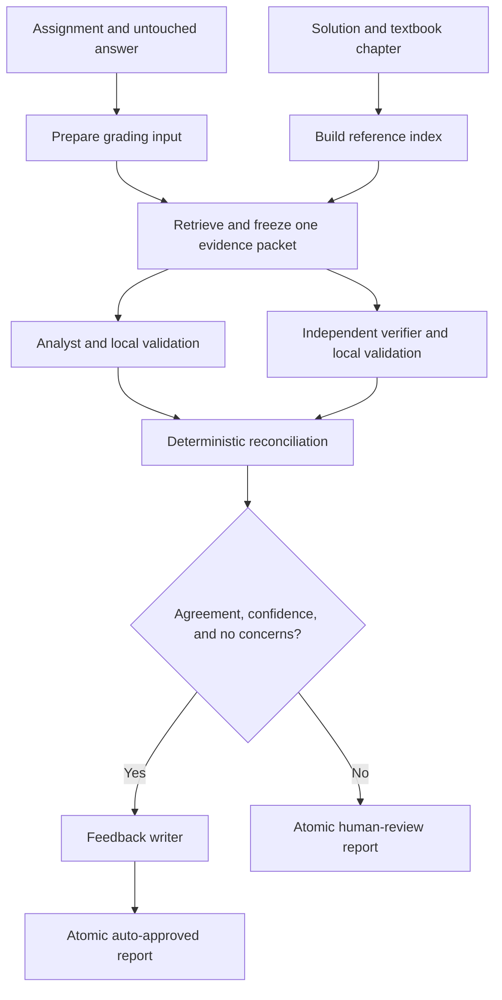

# Homework TA

A mathematical homework assistant that produces two independent, evidence-backed assessments
and uses deterministic Python rules to decide whether the result can be approved automatically.
The project prioritizes traceability, conservative review, and maintainable code.

The current application processes **one question from one student per run**. It is a Python CLI.
Its analyst, verifier, and conditional feedback writer use the same configured provider/model in
separate requests. Retrieval and reconciliation are ordinary Python operations.

Read the [owner's walkthrough](docs/OWNER_GUIDE.md) for a complete explanation of the architecture
and code. Read [skills and tools](docs/skills-and-tools.md) for reviewed additions and priorities.
The [Dahl diagnosis](docs/dahl-workflow-diagnosis.md) records the completed one-student test.

## Contents

- [Capabilities and workflow](#capabilities-and-workflow)
- [Setup and first run](#setup-and-first-run)
- [Project files](#project-files)
- [Provider configuration](#provider-configuration)
- [Another assignment or student](#another-assignment-or-student)
- [Reference retrieval and citations](#reference-retrieval-and-citations)
- [Assessment, validation, and retries](#assessment-validation-and-retries)
- [Reports and human review](#reports-and-human-review)
- [Logs and troubleshooting](#logs-and-troubleshooting)
- [Development and remaining work](#development-and-remaining-work)

## Capabilities and workflow

Implemented: reusable assignment JSON, separate student submissions, immutable grading contracts,
local SQLite FTS5 retrieval, independent assessments, verifier-only mathematics/LaTeX guidance,
deterministic citation/score validation, conservative reconciliation, conditional student feedback,
configurable OpenAI-compatible inference with LiteLLM failover, bounded logs, TA notes,
red annotated TeX copies, and atomic derived outputs.

Automatic PDF/OCR ingestion, TeX compilation, batch grading, persistent
checkpoints, mathematical tool execution, and a review-approval interface are not implemented.
The supplied solution PDF already has a separate extracted `.txt` file; the indexer reads that text.



The diagram shows information flow. Execution is sequential: evidence, analyst, verifier,
reconciliation, then feedback when approved. The verifier receives no analyst result.

| Outcome | Meaning |
| --- | --- |
| `auto_approved` | Both assessments are valid and satisfy the agreement policy; final total and feedback are present. |
| `human_review` | Both assessments are valid, but their judgments need an instructor; final total and feedback are withheld. |
| Failed run | An input, retrieval, provider, or repeated validation error prevents completion; no new report is written. |

A successful CLI exit can mean `human_review`, not just an automatically approved grade.

## Setup and first run

### 1. Install the environment

Use [uv](https://docs.astral.sh/uv/) and run commands from the repository root. The package requires
Python 3.12 or newer; `.python-version` currently selects Python 3.14 for uv.

```console
cd /Users/rezayov/projects/Agentic_TA
uv sync --locked --dev
```

### 2. Configure the credential

For a fresh checkout, create `.env` only if it does not already exist:

```console
test -f .env || cp .env.example .env
chmod 600 .env
```

Set these entries in `.env`, replacing the placeholder with the provider credential:

```dotenv
HOMEWORK_TA_PROVIDER_CONFIG=config/provider.jsonc
HOMEWORK_TA_LLM_API_KEY=replace-with-your-provider-key
```

This machine already has a configured `.env`. Keep it private; `.gitignore` excludes it and
`.env.example` contains a placeholder. The application reads process environment variables:
`uv run --env-file .env` loads the file for that command. The application itself does not
automatically discover `.env`.

### 3. Build the reference index

```console
uv run homework-ta-index \
  data/qft1_hw1/indexes/references.sqlite3 \
  data/qft1_hw1/references/reference_solution.txt \
  data/qft1_hw1/references/relevant_chapter.tex
```

Rebuild after changing reference text or chunk settings. Index the official solution and chapter;
keep student answers out of the reference index. The rubric is already grading data in the
assignment JSON, not an instruction source for the program.

### 4. Prepare the student input

```console
uv run homework-ta-prepare \
  data/qft1_hw1/assignment.json \
  data/qft1_hw1/submissions/403200498.tex \
  --output data/qft1_hw1/work/403200498.json
```

Preparation reads UTF-8 answer text, trims outer whitespace, and combines it with the assignment.
It does not compile TeX or select individual problems from a multi-question homework. Supply an
answer corresponding to the question being graded.

### 5. Grade it

```console
uv run --env-file .env homework-ta \
  data/qft1_hw1/work/403200498.json \
  --reference-db data/qft1_hw1/indexes/references.sqlite3 \
  --output data/qft1_hw1/outputs/403200498-example-run.json \
  --log-file logs/403200498-example-run.jsonl
```

Long mathematical assessments can take several minutes. Watch progress in another terminal:

```console
tail -f logs/403200498-example-run.jsonl
```

The CLI prints the status and report path on completion. The completed Dahl test is saved at
`data/qft1_hw1/outputs/403200498-dahl.json`; this example preserves it by using another output path.
Reusing an output path atomically replaces that derived report after successful completion.

### Small non-student smoke test

The algebra fixture uses synthetic data and manual source material, so it needs no reference index:

```console
uv run --env-file .env homework-ta \
  tests/fixtures/example_input.json \
  --output tmp/algebra-smoke-report.json \
  --log-file logs/algebra-smoke.jsonl
```

This makes real inference requests. The automated pytest suite uses fake responses and needs no
provider credential.

## Project files

```text
Agentic_TA/
├── README.md                         Setup, operation, and workflow
├── AGENTS.md                         Development constraints
├── pyproject.toml / uv.lock           Package, scripts, dependencies
├── .env.example                      Config path and credential placeholder
├── config/provider.jsonc             Non-secret active provider profile
├── src/homework_ta/
│   ├── domain/                       Contracts and deterministic grading rules
│   ├── application/                  Ports, use cases, sequential workflow
│   ├── infrastructure/               HTTP provider, reference index, chunking
│   ├── interfaces/                   Three command-line entry points
│   ├── config.py                     Settings loading and validation
│   └── observability.py              JSON logging and rotation
├── prompts/                          Analyst, verifier, math guidance, feedback
├── agent-skills/math-reasoning/       Upstream skill and provenance
├── agent-skills/latex-formatting/     Upstream LaTeX skill and provenance
├── data/qft1_hw1/
│   ├── assignment.json               Question and 20-criterion rubric
│   ├── manifest.json                 Original/canonical mappings and hashes
│   ├── submissions/                  Canonical student copies
│   ├── references/                   Rubric, PDF, extracted solution, chapter
│   ├── indexes/                      Generated SQLite index
│   ├── work/                         Prepared inputs
│   └── outputs/                      Reports
├── tests/                            Tests and fixtures
├── docs/                             Owner guide, architecture, diagnosis, decisions
└── logs/                             Private diagnostics
```

Original `homeworks/` and `Ref/` files remain separate. The manifest records 11 original submission
files and 10 unique submissions, including one exact duplicate. Generated indexes, prepared inputs,
reports, and logs are ignored by Git. Original/canonical student data are sensitive and are not
automatically excluded by all those ignore rules.

## Provider configuration

The active [profile](config/provider.jsonc) uses Dahl:

```jsonc
{
  // Non-secret connection settings. Credentials belong in .env.
  "base_url": "https://inference.dahl.global/v1",
  "api_key_env": "HOMEWORK_TA_LLM_API_KEY",
  "model": "zai-org/GLM-5.3-Flash",
  "timeout_seconds": 120,
  "max_retries": 1,
  "send_temperature": false,
  "stream": true,
  "response_format": "json_schema",
  "max_tokens": 16384,
  "reasoning_effort": "low",
  "max_response_bytes": 10000000
}
```

The loader supports line and block comments (`//`, `/* ... */`), not trailing commas. Unknown
fields and config files larger than 64,000 bytes are rejected.

| Field | Meaning |
| --- | --- |
| `base_url` | Required API root; the client appends `/chat/completions`. |
| `model` | Required exact provider model identifier. |
| `api_key_env` | Credential variable; defaults to `HOMEWORK_TA_LLM_API_KEY`. |
| `timeout_seconds` | Positive network timeout, not a total streaming/workflow deadline. |
| `max_retries` | Additional transport attempts, 0–10; `1` means up to two attempts. |
| `send_temperature` | Send the request's sampling parameter or omit it; normal request value is 0.0 when sent. |
| `stream` | Request OpenAI-style SSE; defaults to false when omitted. |
| `response_format` | `json_schema` (default), `json_object`, or `prompt`. |
| `max_tokens` | Optional output-token budget, 1–65,536; reasoning may also consume it. |
| `reasoning_effort` | Optional `low`, `high`, or `max`, sent through `chat_template_kwargs`; provider support varies. |
| `max_response_bytes` | Transport cap, 1,024–10,000,000 bytes, including SSE and reasoning overhead. |

`json_object` requests JSON without provider-side schema enforcement. `prompt` omits the provider
format parameter but keeps the schema in the prompt. All modes keep local validation. There is no
automatic format fallback or model switch.

### Overrides and defaults

For endpoint/model: CLI override → environment override → JSONC → built-in default. For
timeout/retries/response size: the corresponding environment override → JSONC → default.
The credential is read from the variable named by `api_key_env`.

| Environment variable | Purpose |
| --- | --- |
| `HOMEWORK_TA_PROVIDER_CONFIG` | Profile path, relative to the working directory unless absolute. |
| `HOMEWORK_TA_LLM_API_KEY` | Default key variable; a profile may name another variable. |
| `HOMEWORK_TA_LLM_BASE_URL` | Override API root. |
| `HOMEWORK_TA_LLM_MODEL` | Override model. |
| `HOMEWORK_TA_LLM_TIMEOUT_SECONDS` | Override network timeout. |
| `HOMEWORK_TA_LLM_MAX_RETRIES` | Override transport retries. |
| `HOMEWORK_TA_LLM_MAX_RESPONSE_BYTES` | Override response cap. |
| `HOMEWORK_TA_MINIMUM_CONFIDENCE` | Confidence threshold, 0–1; default 0.70. |

Stream, format, token, reasoning, and sampling options are JSONC controls, not additional CLI flags.
To add another provider, create another non-secret profile, name its credential variable, and
point `HOMEWORK_TA_PROVIDER_CONFIG` to it. Validate compatibility on synthetic data first.

Without a profile, development defaults are `http://localhost:8000/v1`, `local-model`, a non-secret
placeholder key, a 60-second timeout, two additional retries, and a 1 MB response limit. With a
profile, its named credential variable must be set. Remote URLs require HTTPS; plain HTTP is
allowed only on loopback. URL credentials, query parameters, and fragments are rejected.

### Data sent to inference

The question, rubric, answer, supplied/retrieved source text, and citation schema go to the
configured inference service. Dahl is a remote provider. Indexing, retrieval, grading rules,
reconciliation, and file handling run locally. Feedback uses a smaller context with the question,
answer, criterion descriptions, and approved evidence; numeric score fields are omitted.

## Another assignment or student

Create a reusable `AssignmentDefinition` JSON, for example:

```json
{
  "question_id": "algebra-1",
  "question": "Solve 2x + 3 = 11 and justify each transformation.",
  "rubric": {
    "title": "Linear equation rubric",
    "criteria": [
      {"criterion_id": "method", "description": "Uses valid transformations.", "max_points": 2},
      {"criterion_id": "result", "description": "Obtains x = 4.", "max_points": 1}
    ]
  },
  "source_material": []
}
```

Criterion IDs must be unique and maxima positive. Manual sources have `source_id`, `location`,
and `content`. Their IDs must be unique; `student_answer` is reserved for the submitted answer.
There is no automatic Markdown-rubric conversion. A complete grading input contains `submission`,
`rubric`, and `source_material`; see [the fixture](tests/fixtures/example_input.json).

```console
uv run homework-ta-prepare \
  path/to/assignment.json \
  path/to/student-answer.tex \
  --submission-id student-001 \
  --output data/my-assignment/work/student-001.json
```

The submission ID defaults to the filename stem. Preparation rejects an output equal to the
assignment or original answer and writes a derived JSON atomically. PDFs need a separately checked
text extraction first. Build the assignment's reference index, then grade its prepared JSON into
an `outputs/` path. Processing every question in one file is not automatic.

| Command | Interface |
| --- | --- |
| `homework-ta-prepare` | `assignment answer --output PATH`; optional `--submission-id`. |
| `homework-ta-index` | `database reference [reference ...]`; optional `--chunk-characters` (default 2,400). |
| `homework-ta` | `input`; optional `--output`, `--reference-db`, `--retrieval-limit`, `--log-file`, `--base-url`, `--model`, `--prompts-dir`. |

Grading defaults to `grade-report.json`, `logs/homework-ta.jsonl`, and eight retrieval hits.
Without `--reference-db`, only manual `source_material` is used. Each command supports `--help`.

## Reference retrieval and citations

RAG is local keyword retrieval using SQLite FTS5, without embeddings or an extra model call:

1. Read `.md`, `.txt`, or `.tex`, normalize text, recognize simple headings, and pack paragraphs
   into bounded chunks. Default chunk size: 2,400 characters; allowed range: 500–20,000.
2. Assign source IDs, display locations, content hashes, and an ordered index fingerprint.
3. Build a query from the question and rubric only. The student's answer does not influence it.
4. Remove stop words, take up to 48 distinct terms, and run a quoted OR query. Rank with BM25 and
   deterministic row-order tie breaking.
5. Verify returned locations/hashes and apply a retrieved-text budget: eight passages and 24,000
   characters by default. `--retrieval-limit` permits 1–20 passages; the character budget is a
   constructor setting, not a CLI option.
6. Merge with manual sources and freeze one immutable input for both assessors. Source-ID conflicts
   or failed retrieval stop the run.

The character budget covers retrieved passages, not the answer or all manual sources. Reports
record the full query, index fingerprint, ranks, IDs, locations, and hashes. They do not retain the
transformed FTS query or duplicate all passage text; preserve the index and references to reproduce
the packet. Hashes support integrity/reproducibility, not mathematical truth or passage relevance.
The text chunker is not a full TeX parser and does not supply original PDF page offsets.

Assessment schemas list permitted source/criterion IDs, require the full criterion count, and
include a shared deterministic quote catalog: up to 64 excerpts per source, each at most 300
characters. The catalog includes the answer and frozen references; full text remains available.

Local citation checking requires a known source and a quote found in that source after whitespace
normalization and case folding. It does not render/rewrite LaTeX or prove relevance. Model-written
`Evidence.location` is not checked as an exact span; trusted chunk locations are recorded separately
in the retrieval trace.

## Assessment, validation, and retries

| Role | Input | Output |
| --- | --- | --- |
| Analyst | Analyst prompt, schema, frozen input | All rubric criteria with proposed points and evidence. |
| Verifier | Verifier prompt + math/LaTeX guidance, its schema, same input | Independent judgments, never analyst conclusions. |
| Feedback writer | Approved evidence, criterion descriptions, question/answer | Summary, strengths, improvements, 2–4 diagnostic questions. |

The vendored packages live in `agent-skills/math-reasoning/` and `agent-skills/latex-formatting/`,
with provenance in their `SOURCE.md` files. Runtime explicitly composes the verifier prompt with
`prompts/verifier_math_skill.md` and `prompts/verifier_latex_skill.md`, not the whole upstream folders.
The first guides mathematical assumptions and checks; the second guides interpretation of raw
LaTeX, notation uncertainty, source-preserving citations, and JSON escaping. Neither skill grants
a calculator, shell, Python runner, symbolic tool, or TeX compiler. The analyst and feedback writer
receive neither skill. `verifier_skills_loaded` logs their identities and prompt hashes.

Pydantic parses the output into immutable contracts, rejects undeclared fields, and enforces
field bounds and roles. Python scoring additionally checks unique and complete criterion coverage,
nonnegative points within rubric maxima, source IDs, quote matches, and deterministic Decimal totals.
The model does not supply the accepted total.

The input-specific JSON schema guides/provider-constrains generation. Acceptance uses Pydantic and
the scoring rules rather than a separate generic validator for every dynamic schema constraint.
For example, a real source substring outside the suggested quote catalog can pass the local rule.

| Retry layer | Trigger | Current setting |
| --- | --- | --- |
| Transport | Retryable HTTP statuses, connection/timeout failures, incomplete/empty streams | One additional attempt in the active profile. |
| Validation | Invalid JSON/contract; citation or scoring errors for assessments | One fresh additional attempt. |

Retryable HTTP statuses include 408, 409, 425, 429, and server errors. Backoff is bounded.
Numeric `Retry-After` cooldowns up to 60 seconds are respected; longer cooldowns stop the
request instead of retrying prematurely. Other header forms use the default backoff. Stream
acceptance requires assistant content, normal `stop`, and `[DONE]`. A `length` stop is rejected.
A validation retry receives the same input/schema and concise error feedback, never the prior full
completion. The other assessor receives none of this retry feedback.

Current settings allow up to four transport requests per role across two validation attempts.
A verifier retry preserves the validated analyst in the current process. There is no persistent
checkpoint; a fresh CLI invocation repeats the workflow. Repeated invalid output aborts the run
rather than producing a human-review report with invalid assessments.

## Reports and human review

| `GradeReport` field | Meaning |
| --- | --- |
| `submission_id`, `question_id`, `generated_at` | Identity and report creation time. |
| `retrieval` | Query, index fingerprint, ordered passage metadata; null without RAG. |
| `analyst`, `verifier` | Validated judgments, criterion explanations/evidence, proposed totals, maxima. |
| `reconciliation` | Status, criterion comparisons, final total if approved, review issues. |
| `feedback` | Student feedback for `auto_approved`; otherwise null. |

Approval requires exact score agreement **per criterion**, both confidences at or above the
threshold, and no concerns. Equal totals alone do not suffice. Reconciliation uses the lower
confidence per criterion; any explicit concern triggers review even when scores agree.

There is no averaging, majority vote, automatic tie-break agent, or silent score correction.
In a review report, agreed criterion values may remain visible, but the final total is null.
The full report is an instructor/audit artifact rather than a student-facing document.

### Completed QFT test

On 2026-10-12, student `403200498` completed the workflow with 20 criteria and eight reference
passages. The report is `data/qft1_hw1/outputs/403200498-dahl.json`:

| Result | Value |
| --- | --- |
| Status | `human_review` |
| Analyst proposal | 9.00/10 |
| Verifier proposal | 9.25/10 |
| Review issues | D5/D6 confidence 0.60; D6 disagreement (0.25 versus 0.5). |
| Approved final total / student feedback | Withheld |

Both assessments passed citation, coverage, and score validation; the original hash stayed
unchanged. One successful execution is not an instructor-calibrated accuracy benchmark.

### Instructor action

Read review issues, compare the disputed criterion explanations/evidence with the original answer
and rubric, and record a separate instructor decision. There is currently no review-resolution CLI,
gradebook integration, or automatic continuation from manual approval to feedback. Preserve the
generated audit report rather than editing model output to manufacture agreement.

## Logs and troubleshooting

Each run has a `run_id`. Logs rotate at approximately 5 MB with three backups. Unix log files are
`0600`; their directory is set to `0700` when possible. Reports made by atomic temporary-file writes
also have restrictive file permissions on the tested Unix environment.

Key events: `verifier_skills_loaded`, `evidence_packet_frozen`, `assessment_started`, `assessment_completed`,
`provider_request_started`, `provider_stream_progress`, `provider_stream_finished`,
`provider_response_received`, `provider_connection_error`, `provider_http_error`,
`provider_incomplete_stream`, `structured_validation_failed`, `assessment_validation_failed`,
`reconciliation_completed`, `feedback_withheld_for_human_review`, and `grading_run_completed`.

Logs intentionally omit credentials, prompts, answers, full completions, and provider reasoning
text. They include IDs, hashes, field/validation metadata, timings, optional token usage, and text
lengths; treat them as private diagnostics. A criterion's short `reasoning` in the report is separate
from provider reasoning chunks, whose text is ignored.

| Symptom | Interpretation / next check |
| --- | --- |
| Missing key | Check `.env`, `api_key_env`, and `--env-file .env`. |
| Invalid JSONC | Check supported keys and comment syntax; omit trailing commas. |
| HTTP 401 | Check the provider credential. |
| HTTP 429 | Provider throttling/capacity; check availability and retry later. |
| Connection closes | Service/transport failure; inspect the tested stream profile and bounded retries. |
| Incomplete/empty stream | No usable completed answer; transport retries apply within their limit. |
| `length` stop | Truncated output; inspect token budget/provider limits. |
| Repeated validation failure | Inspect criterion/source/schema errors; correct input or guidance without weakening score checks. |
| No relevant passages | Check indexed references, database path, and question/rubric terms. |
| Hash conflict | Rebuild from authoritative references and preserve source provenance. |
| `human_review`, feedback null | Expected policy outcome; read review issues. |
| Error but old report exists | Failure writes no new report; check completion/run ID and use distinct paths. |

Grading exits 0 after writing either successful status, 1 for handled runtime failures, and normally
2 for argument errors. Failure leaves any prior output file unchanged. Only a new completion
message/event confirms a newly written report.

## Development and remaining work

Pydantic is the only declared application dependency. HTTP, SQLite, hashing, Decimal arithmetic,
files, and logging use Python's standard library. Development dependencies are pytest and Ruff.

```console
uv run pytest
uv run ruff check .
uv run ruff format --check .
```

The last verified suite has 45 passing tests: approved feedback, review routing, verifier isolation,
shared retrieval, quote catalogs, invalid citations, streaming/retries, settings, original-file
protection, and privacy-oriented logs. These local checks need no live API and do not establish
mathematical accuracy or remote-service availability.

Follow `AGENTS.md`: deterministic grading stays in `domain/`; use cases depend on application
ports; external implementations stay in `infrastructure/`; CLI/file interaction stays in
`interfaces/`. Keep prompts in separate files and add tests for behavior changes.

Recommended next work: instructor-calibrated evaluations, a review-resolution path, bounded
symbolic checks, and reproducible PDF extraction. A vector store, orchestration framework, or
microservice should follow a demonstrated requirement. See the
[reviewed tools and priorities](docs/skills-and-tools.md).

## Ordered provider failover and student output files

LiteLLM SDK routing is enabled by `HOMEWORK_TA_ROUTER_CONFIG=config/router.jsonc`
(or `--router-config config/router.jsonc`). This takes precedence over the legacy
single-provider configuration. Load the ignored `.env` before running:

```sh
set -a
source .env
set +a
uv run homework-ta data/qft1_hw1/work/403200498.json \
  --reference-db data/qft1_hw1/work/textbooks.sqlite3 \
  --output-dir data/qft1_hw1/outputs
```

The ordered configuration selects GCAT first, trying `agy/gemini-3.8-flash-high`
then `cx/gpt-6-luna-medium` at `https://core.g-cat.ir/v1` using `GCAT_API_KEY`.
It then tries AgentRouter (`deepseek-v4-flash`), Dahl (`zai-org/GLM-5.3-Flash`),
and Hormouz (`qwen/qwen3.8-flash`). No Kenrai endpoint or credentials were found.
Credentials belong in `.env`, never JSONC.

Each provider has an ordered `models` list sharing its endpoint, credential and
request settings. For example:

```json
{
  "name": "gcat",
  "base_url": "https://core.g-cat.ir/v1",
  "api_key_env": "GCAT_API_KEY",
  "models": ["agy/gemini-3.8-flash-high", "cx/gpt-6-luna-medium"]
}
```

The legacy single `model` field still works; do not supply both fields. Lists must
contain 1–10 unique, non-empty model IDs. Each model gets the configured failure
threshold before trying the next model. Once every model in a provider fails,
routing advances to the next provider. A working provider/model remains selected
for the rest of the run. Missing credentials skip that provider's entire list.

`failure_threshold` accepts **2 or 3 total failed attempts per model**, including
the initial request. `retry_delay_seconds` is the pause between attempts. Each
provider can set its own timeout, streaming, token budget, response size limit,
and JSON response mode, using the same fields as the single-provider configuration
except `max_retries`; SDK retries are disabled so the threshold stays exact.
Missing keys skip a provider with a diagnostic event. If no key is configured,
startup fails. After transport errors, rejected requests, empty/truncated output,
or JSON schema failures, the router moves to the next model/provider and keeps it for
the remainder of that process. A new invocation starts at the first provider.
All-provider failure aborts safely. Domain validation and human-review policy
remain authoritative; routing never resolves grading disagreements.

The identical frozen request is retried across providers. No completion or assessor
conversation is cached by the router. Privacy-safe logs identify provider, attempt,
schema name, model and exception type; provider exception bodies are suppressed.

Each completed run writes:

```text
outputs/<student-number>/
  grade-report.json
  ta-notes.txt
  annotated-answer.tex
```

Use `--output-dir` to choose the output root. A submission ID such as
`403200498_name` selects `403200498`; other safe IDs are retained. If the input
omits its ID, the input filename stem is used. `--output` still supports an explicit
JSON report path; the notes and TeX use the student folder. Each file is written
atomically. Reusing a student folder replaces these derived files; multi-file writes
are not transactional. The original input and answer are never overwritten.

The TeX copy appends red, escaped instructor annotations before `\end{document}`.
For plain answers it creates a minimal TeX wrapper. It contains both assessors'
comments and citation locations, and is an **instructor-only artifact**. Human-review
cases explicitly withhold the final score and label the pending status. These are
appended notes, not changes to individual equations. The application does not
compile or execute student TeX; document/package compatibility still needs inspection.

AgentRouter's [Hermes integration guide](https://agentrouter.org/docs/hermes.html)
confirms `https://agentrouter.org/v1` and `deepseek-v4-flash`.
The adapter follows [LiteLLM's OpenAI-compatible endpoint documentation](https://docs.litellm.ai/docs/providers/openai_compatible).

Check the configured models without sending student data:

```sh
uv run homework-ta-check-provider --provider agentrouter
uv run homework-ta-check-provider --provider hormouz
uv run homework-ta-check-provider
```

The provider-specific commands test only the named provider; the last tests the
ordered fallback chain.
Both require a schema-valid arithmetic answer of 14, and write privacy-safe attempt
logs to `logs/provider-check.jsonl`. Passing checks connectivity and basic JSON/math
behavior, not mathematical grading quality.
