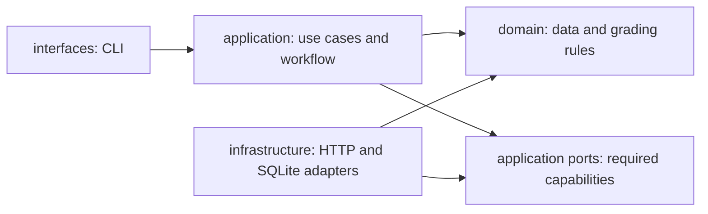

# Owner's guide: how Homework TA works

This guide is for understanding and maintaining your project. Start with the explanation below,
then follow the code map when you want to change something. Use the [README](../README.md) for
commands and provider settings, and the [skills/tools review](skills-and-tools.md) for additions.

## 1. What you have built

The application is a small grading pipeline with two independent mathematical assessors. A
computer program prepares their evidence, checks whether their answers obey the grading contract,
and compares their judgments. An optional third model call writes student feedback after approval.

Think of an instructor handing the same folder to two graders. Each grader works separately. The
instructor's fixed rules determine whether their judgments agree enough to release a grade. In
this project, Python handles the folder and fixed rules; the language model supplies the judgments.

There are two different kinds of work:

| Work | Who does it? | Examples |
| --- | --- | --- |
| Mathematical judgment | Analyst and verifier model calls | Decide whether an argument meets a rubric item; explain uncertainty. |
| Mechanical checks and policy | Deterministic Python code | Check citations, maxima, totals, criterion coverage, confidence threshold, and agreement. |

A valid JSON assessment is not a proof of mathematical correctness. It means the response passed
the structure and mechanical checks. Independent assessment, conservative review, and future
instructor calibration address the judgment side of the problem.

## 2. What an agent means here

An agent is currently a role-specific request to the language model, consisting of a system prompt,
a response schema, and input data. It does not have its own operating-system process, persistent
memory, Python execution tool, shell, browser, or autonomous planning loop.

The program has one provider client. It makes separate calls for these roles:

- Analyst: evaluate the student's argument against every rubric criterion.
- Verifier: independently reconstruct/check the mathematics from the original materials.
- Feedback writer: explain an approved assessment respectfully to the student.

All three currently use the same model ID and API endpoint. Their contexts differ, and each
completion request contains fresh messages rather than a shared conversation history. A future
different-model verifier would require explicit configuration/wiring changes; it is not already
implemented.

The verifier runs after the analyst in time, but not after reading the analyst's answer. Execution
order and information dependence are separate ideas. Its method deliberately accepts only
`GradingInput`, not an analyst assessment.

## 3. The files are the starting point

An assignment defines one question and the instructor's scoring criteria. A submission supplies
one student's answer. References supply the official solution and relevant textbook material.

```text
assignment.json       question + rubric + optional manual sources
student-answer.tex    original answer text
reference files       authoritative reference material
        |
        +--> prepare command --> work/student.json
        +--> index command   --> indexes/references.sqlite3
                                 |
work/student.json + reference index --> grading run --> outputs/student-report.json
```

The prepared input separates reusable assignment content from each student answer. This prevents
editing the rubric/question independently for every student and makes it clear which assignment
was used. The preparer reads the full answer file as text; it does not choose a problem from a
multi-problem submission or compile LaTeX.

For QFT I Homework 1, `data/qft1_hw1/` is the working layout. `manifest.json` preserves mappings and
hashes for original `homeworks/` and `Ref/` files. `work/`, `indexes/`, and `outputs/` hold derived
artifacts. Always choose derived output paths rather than a submission/reference path.

## 4. Architecture: why the code is divided this way

The architecture separates grading policy from the systems used to run it.



These arrows represent code dependencies, not runtime order. The CLI constructs the real adapters
and passes them into the application. The application knows the port contracts, and the adapters
fulfill those contracts. The domain does not import the provider, CLI, retrieval implementation,
or workflow.

### Domain: the grading vocabulary and fixed rules

`domain/` defines what an assignment, assessment, evidence item, and report mean. It also defines
what is acceptable mechanically and how agreement is decided. It can be tested without a network
or textbook database.

Changing providers should not change the meaning of a rubric maximum or the agreement policy.
That is why these rules are not inside an HTTP client or model prompt alone.

### Application: coordinating a use case

`application/` decides which steps happen and what information each step receives. It prepares
the evidence packet, invokes the assessor roles, calls domain validation, reconciles the results,
and invokes feedback when permitted.

It depends on protocols called ports. A port states a capability the application needs, such as
“complete this model request” or “retrieve these reference passages.” It does not say which server
or storage engine must provide it.

### Infrastructure: implementing external capabilities

`infrastructure/` implements the ports using an OpenAI-compatible HTTP API and SQLite FTS5. It
understands HTTP headers, streaming frames, connection failures, database queries, and chunk hashes.
It does not decide which disputed score should win.

### Interfaces: the program's entrance and exit

`interfaces/` parses command-line arguments, reads bounded files, constructs the application and
adapters, writes reports, and returns process exit codes. This construction is sometimes called
the composition root: it is where abstract capabilities get concrete implementations.

`config.py` and `observability.py` are shared setup/diagnostic modules. Domain rules remain separate
from provider settings and logging setup.

## 5. Code map: where to read or change things

Paths below are relative to `src/homework_ta/` unless a different directory is shown.

| File | Main responsibility |
| --- | --- |
| `domain/models.py` | Pydantic contracts, role-specific assessments, input-specific schema, quote catalog, report types. |
| `domain/scoring.py` | `validate_and_score()` and `reconcile()`; exact deterministic acceptance and approval rules. |
| `domain/rubric.py` | Small rubric-order helper; it is not a rubric parser or scoring engine. |
| `application/ports/llm.py` | `ChatMessage`, `LLMRequest`, `LLMResponse`, and `LanguageModel` protocol. |
| `application/ports/reference_retriever.py` | Retrieval protocol and typed retrieval error. |
| `application/use_cases/build_evidence_packet.py` | Query construction, retrieval verification, text budget, frozen input. |
| `application/use_cases/_structured.py` | Schema prompt, JSON parsing, optional domain validator, bounded fresh retries. |
| `application/use_cases/analyze_answer.py` | Analyst request and validated/scored result. |
| `application/use_cases/verify_assessment.py` | Independent verifier request; accepts no analyst result. |
| `application/use_cases/reconcile_assessments.py` | Passes the validated pair and confidence threshold into domain reconciliation. |
| `application/use_cases/generate_feedback.py` | Builds approved, score-field-free feedback context. |
| `application/workflows/grade_submission.py` | Sequential end-to-end control flow and stage logging. |
| `infrastructure/llm/openai_compatible.py` | HTTP requests, format options, SSE, response bounds, retryable errors, completion parsing. |
| `infrastructure/references/chunking.py` | Heading/paragraph chunking and stable chunk identities. |
| `infrastructure/references/sqlite_fts.py` | Atomic index building, read-only search, ranking, integrity checks. |
| `interfaces/prepare_cli.py` | Assignment + answer → prepared JSON. |
| `interfaces/index_cli.py` | Reference files → generated index. |
| `interfaces/cli.py` | Grading arguments, dependency wiring, report write, errors/exit codes. |
| `config.py` | JSONC and environment configuration, URL validation, settings. |
| `observability.py` | Correlated JSON-lines diagnostics, permissions, rotation. |
| `__main__.py` | Python module entry point delegating to the grading CLI. |
| Project `prompts/` | Role instructions and verifier math/LaTeX guidance, separate from Python. |
| Project `tests/` | Behavioral examples and regression protection. |

Good reading order: workflow → assessor use cases → structured helper → domain scoring → model
contracts → evidence builder → provider adapter → CLI. This follows the important behavior before
the wiring details.

## 6. Data contracts: what travels between components

| Type | What it carries |
| --- | --- |
| `AssignmentDefinition` | Reusable question ID, question, rubric, optional manual excerpts. |
| `Submission` | Student/submission identity, question ID, question, answer. |
| `Rubric` / `RubricCriterion` | Unique criterion IDs, descriptions, positive maxima. |
| `GradingInput` | Submission + rubric + supplied/frozen source material. |
| `SourceExcerpt` | Source ID, location, text. |
| `EvidencePacket` | Frozen grading input plus retrieval trace. |
| `RetrievalTrace` / `RetrievalHit` | Query, fingerprint, ranks, IDs, locations, content hashes. |
| `Evidence` | Cited source ID, model location label, quote, explanation. |
| `CriterionAssessment` | Proposed points, confidence, explanation, evidence, concerns. |
| `AnalystAssessment` / `VerifierAssessment` | Fixed role and criterion judgments. |
| `ScoredAssessment` | Validated assessment plus locally calculated total and maximum. |
| `ReconciliationResult` | Approval/review status, comparisons, issues, final total if permitted. |
| `StudentFeedback` | Summary, strengths, improvements, two to four diagnostic questions. |
| `GradeReport` | Both assessments, reconciliation, retrieval trace, and optional feedback. |

Most contracts inherit `StrictModel`, configured with forbidden extra fields, frozen instances,
and whitespace trimming. Frozen objects and tuple collections make accidental mutation difficult.
The name does not mean Pydantic's global `strict=True` mode: permitted conversions, including
numeric strings into Decimal scores, can still occur. Field bounds and deterministic rules provide
the important acceptance checks. See [Pydantic's model documentation](https://docs.pydantic.dev/latest/concepts/models/).

Decimal scores avoid binary floating-point addition artifacts in totals. Confidence is still a
model-reported floating-point value; it is not a calibrated probability simply because it lies
between zero and one.

## 7. RAG: how the textbook reaches the assessors

RAG means finding relevant reference text before asking the model to assess. It does not train
the model or automatically verify a proof.

The offline indexer reads reference Markdown, text, or LaTeX, finds simple headings, packs
paragraphs into bounded chunks, and stores them in a SQLite FTS5 table. Chunk IDs depend on source
identity, location, and content hash. An index fingerprint depends on the ordered chunk identities
and hashes. Rebuilding unchanged inputs/settings in the same order is reproducible.

At grading time:

1. `_build_query()` uses the question and rubric only.
2. SQLite search turns that text into up to 48 distinct search terms, then ranks matching chunks.
3. Returned chunk content is checked against its stored hash.
4. `BuildEvidencePacket` verifies the query, IDs, locations, and hashes, applies the passage/text
   budgets, merges manual sources, and constructs a new immutable `GradingInput`.
5. The workflow passes this same object to both assessors and records its hash in the log.

The default is eight passages with a 24,000-character retrieved-text budget. The answer and manual
excerpts are separate from that budget. No-results, corrupted hits, or source conflicts raise an
error rather than letting the model guess a missing reference.

### Why both agents share the RAG packet

If only the verifier sees the textbook, a disagreement can reflect different information instead
of different reasoning. If each agent performs a separate search, they can receive different
passages. The current design searches once and freezes the result before either assessment, making
comparison fairer and reproducible.

The student answer does not choose the primary reference query. It naturally participates in
assessment and the quote catalog after retrieval; those are different operations.

This is keyword retrieval. It may miss relevant text expressed with different vocabulary, and
mathematical notation/complex LaTeX headings can be awkward. The trace records the original query,
not the transformed FTS expression. Locations describe chunks rather than PDF page/character
offsets. These are concrete future improvements if evaluation shows retrieval failures.

## 8. The citation catalog is different from RAG

RAG selects textbook passages. The citation catalog offers exact excerpts from the input already
selected. It performs no extra reference search and contains no assessor conclusions.

`citation_quotes()` splits each supplied text into lines, trims edges, caps excerpt length at
300 characters, prefers lines at least 12 characters long when available, samples up to 64 excerpts
per source with a deterministic stride, and removes duplicates. Both roles receive identical
choices because the source packet is identical.

`Assessment.schema_for_input()` adds:

- allowed source IDs, including the reserved `student_answer`;
- allowed rubric criterion IDs;
- the exact required criterion count;
- a quote enum containing those exact excerpts.

This makes copying reliable and reduces invented IDs/quotes. The full answer and reference passages
remain available, so judgment does not rely only on short excerpts. The catalog is a constrained
generation aid, not a complete summary of all possible evidence.

The domain validator checks a quote against its claimed source after whitespace normalization and
case folding. It does not accept paraphrases or render LaTeX. It also does not require membership
in the catalog as a separate local rule: a different genuine source substring can pass. That
distinction matters because provider schema enforcement varies.

An evidence quote's presence proves that it exists in a source, not that its explanation is
correct. The model-provided location string is not independently checked as an exact source span;
the retrieval trace has separately checked chunk locations.

## 9. Follow one grading run through the code

### Installed verifier skills

The CLI's `_read_verifier_prompt()` loads `verifier.md`, `verifier_math_skill.md`, and
`verifier_latex_skill.md` into the verifier system prompt. Missing or empty required files stop
startup. This is real runtime integration; it does not depend on Codex discovering a skill folder.
The LaTeX package is vendored under `agent-skills/latex-formatting/`, but only its curated grading
adaptation is used. The original paper-formatting/auto-fix scripts are not executed.

LaTeX guidance helps the verifier interpret equations, defined notation, and references while
preserving the exact raw source in citations. It does not compile the submission, rewrite it,
generate a `.tex` report, or introduce typography penalties absent from the rubric. Both skills
remain verifier-only; both assessors still receive identical frozen grading data.

The CLI validates file paths and reads the grading JSON. It loads settings, builds the provider
adapter, reads prompts, optionally creates the reference retriever/evidence builder, and constructs
the workflow with its collaborators.

The workflow is equivalent to this simplified pseudocode:

```python
packet = build_evidence_packet(input)  # optional when no index is supplied
analyst = analyze(packet)
verifier = verify(packet)  # no analyst argument
decision = reconcile(analyst, verifier, packet)
feedback = write_feedback(decision, packet) if decision.is_approved else None
return report(analyst, verifier, decision, feedback)
```

The real code uses the corresponding typed classes and `ReconciliationStatus`; `is_approved`
above is explanatory shorthand, not a real public method.

### Inside an assessor call

`AnalyzeAnswer.execute()` or `VerifyAssessment.execute()` creates its role-specific schema and
passes the original serialized input to `request_validated()`. That helper builds fresh system/user
messages, requests one JSON object, and clearly labels supplied content as untrusted data.

The adapter posts the request to `/chat/completions`. After completion, Pydantic validates the
contract, and a `validate_and_score()` callback checks the domain rules. Only then does the helper
return a result. The use case returns a `ScoredAssessment` calculated by the same pure scoring rule.

JSON schemas in requests and prompts help the model follow the contract. The actual local acceptance
path is Pydantic plus explicit scoring checks; it does not prove every mathematical assertion.

### Inside the provider adapter

The adapter adds the configured model, fresh messages, stream preference, and response format.
It optionally sends temperature, output budget, and reasoning effort. With Dahl, explicit streaming
avoids the non-streaming disconnects seen during diagnosis.

The reader bounds transport bytes and collects SSE lines. Parsing collects only assistant content,
requires a normal stop and `[DONE]`, and rejects incomplete, empty, failed, or truncated output.
Provider reasoning text is not included in the returned assessment response; diagnostic statistics
record its length only. The final report's criterion rationale is a separate explicit model field.

A 120-second network timeout does not mean the whole run ends in two minutes: an active stream can
continue much longer. Output-token and transport-byte limits are separate bounds.

## 10. Why retries live at two different levels

Transport problems and invalid judgments require different responses.

| Failure | Owner | Response |
| --- | --- | --- |
| Connection, retryable HTTP status, incomplete stream | Provider adapter | Retry the same original request within the configured attempt limit. |
| JSON fields/types, unknown source, changed quote, missing criterion, over-allocation | Structured helper + domain callback | Ask that role for a fresh assessment with concise validation feedback. |
| Valid assessments disagree or show low confidence/concerns | Reconciliation | Produce a human-review report; do not treat disagreement as a transport error. |

The active profile has one additional transport attempt. The helper permits one additional
validation attempt. This can mean up to four HTTP requests per role. These are bounded retries,
not an endless self-correction loop.

The previous full completion is not supplied to the retry, and none of one role's retry feedback
is supplied to the other role. A verifier retry retains the valid analyst object in the running
process, but no checkpoint is saved across process restarts.

If validation retries are exhausted, the workflow aborts without a new report. It cannot safely
reconcile an invalid assessment. A previous report at the same path may still exist; check run IDs,
timestamps, and completion events rather than assuming file existence means the latest run worked.

## 11. Reconciliation: which scores become final?

`reconcile()` compares the two valid assessments criterion by criterion. For each criterion:

1. Compare Decimal points for exact equality.
2. Take the lower of the two reported confidences.
3. Check whether either assessor recorded any concern.
4. Merge evidence without discarding either assessor's explanation.

Any disagreement, below-threshold confidence, or concern becomes a review issue. The entire report
is `human_review` if any issue exists. Some agreed criterion points remain visible, but the final
total is withheld. The threshold defaults to 0.70 and can be set with
`HOMEWORK_TA_MINIMUM_CONFIDENCE`.

For example, two assessors can have the same total but distribute points differently across
criteria; that still requires review. Two assessors can agree on every point and still express
uncertainty; that also requires review. The system never averages scores to conceal disagreement.

Changing a confidence threshold is an instructor policy decision, not a fix for broken citations
or missing criteria. Likewise, adding retries should not retry away a valid disagreement until
the system happens to obtain agreement.

## 12. Feedback and human review

The feedback writer runs only for `auto_approved`. Its context contains the question, student
answer, rubric descriptions, and approved evidence. The program omits numeric score fields and
prompts the writer not to mention the grade. It validates the summary/list structure and requires
two to four diagnostic questions.

This is a separate call to the same model, not a separate model installation. Omitting score
fields is not a complete text-redaction mechanism: numbers or score-like statements in free-text
evidence/explanations are not independently scrubbed, and there is no dedicated feedback score-leak
checker yet. Future evaluation should check feedback accuracy, tone, and grade leakage.

For `human_review`, the writer is intentionally skipped. An instructor reads review issues, checks
the disputed mathematics against the original work/rubric, and records a separate decision. There
is currently no command to resolve a review and resume feedback generation. That next feature
should preserve the original assessments and record the instructor's override explicitly.

## 13. The real student run: what it demonstrates

Student `403200498` was processed against the QFT lattice-propagator question with 20 rubric items
and eight retrieved passages. The saved report is
`data/qft1_hw1/outputs/403200498-dahl.json`. The successful run lasted about seven minutes.

Both assessments passed complete coverage, source/quote validation, and score limits. The analyst
proposed 9.00/10, and the verifier proposed 9.25/10. D5 and D6 had minimum confidence 0.60. D6
differed: 0.25 from the analyst versus 0.5 from the verifier. Therefore the final status is
`human_review`, with no approved total and no student feedback.

This is an end-to-end success of the implemented workflow, including conservative review routing.
It is not a claim that either proposed score is the instructor's correct grade. Both roles use
the same model and can make correlated mistakes. An instructor-labeled evaluation set is the
next important evidence for grading quality.

The saved report was independently revalidated, reconciliation was recomputed, retrieval metadata
was compared with the reconstructed packet, and the original submission hash was checked unchanged.
See the [diagnosis](dahl-workflow-diagnosis.md) for the failures that led to the current fixes.

## 14. File safety, privacy, and reproducibility

Preparation and report/index writing use distinct derived paths and atomic replacement: write a
temporary file, flush it, then replace the completed destination. A failure before report writing
leaves the previous output unchanged. Path-conflict checks protect the files supplied as current
inputs; they are not a global filesystem sandbox for every possible output path. Use the documented
`work/`, `indexes/`, and `outputs/` layout.

The key belongs in ignored `.env`, not the provider JSONC, source files, reports, or shared logs.
Logs intentionally omit keys, prompts, full answer/completion text, and provider reasoning text.
They still contain submission IDs and validation metadata. Reports contain actual quoted student
work and proposed scores; treat them as private instructor artifacts.

With a remote provider, the configured service receives the answer, question, rubric, references,
and citation schema. Local retrieval does not make the inference local. HTTPS protects transport;
it does not define a provider's storage/retention policy.

For reproducibility, retain the assignment, original answer, reference files, generated index,
provider/profile settings, prompt versions, report, and correlated log. Hashes show which content
was used, but do not promise a language model will repeat its judgment on another run.

## 15. Testing: what the 45 tests tell you

The local suite substitutes fake model responses, so it can test behavior without paying for
inference or relying on provider availability. SQLite integration tests create temporary indexes.
Provider tests simulate HTTP responses, disconnections, streams, and retry sequences.

| Test area | Important assurance |
| --- | --- |
| Scoring | Over-allocation, invented sources, fabricated quotes, disagreement, low confidence, concerns. |
| Workflow | Verifier isolation, identical evidence, conditional feedback, full coverage, bounded retries, real LaTeX prompt loading and raw backslash citations. |
| Retrieval | Stable chunk identities, real FTS retrieval, traceable bounded packets. |
| Provider | Request shape, configurable parameters, stream assembly/completeness, size bounds, transport recovery. |
| Configuration | JSONC comments, URLs, secrets by variable name, overrides, unknown fields. |
| Preparation/logging | Original preservation, conflicting output rejection, privacy-oriented diagnostic structure. |

Ruff checks style and likely coding errors, not mathematics. Type hints describe contracts but no
static type checker is currently a declared development dependency. Tests also do not grade a
large instructor-labeled dataset or evaluate the live provider's uptime. The live QFT run adds
one concrete integration example beyond the automated suite.

## 16. How to extend the code without losing its structure

| Desired change | Start here | Keep unchanged |
| --- | --- | --- |
| Another OpenAI-compatible provider | JSONC + ignored credential variable; test synthetic input | Scoring and reconciliation rules. |
| A different API protocol | New infrastructure implementation of `LanguageModel`; CLI wiring | Application use cases/domain contracts where possible. |
| Different retrieval | New `ReferenceRetriever` adapter, benchmark passage relevance | Query excludes answer; one frozen shared packet; trace/hashes. |
| PDF ingestion | Separate extraction boundary before preparation/indexing | Original file, extraction provenance, reference traceability. |
| Mathematical checker | Application port + bounded infrastructure adapter, explicit assumptions/results | No arbitrary student/model code execution; no analyst conclusions passed to verifier. |
| Instructor review resolution | Application use case + explicit decision/audit record + CLI/UI | Preserve both proposals and the original review reasons. |
| A web interface | New interface around existing use cases | Domain policy and provider/retrieval independence. |
| Batch processing | Per-submission orchestration with resource/failure isolation | Separate evidence/report per student; no cross-student context. |

Keep these as prospective changes. Installing a library or Codex skill does not itself implement
any of them. For example, adding SymPy would need explicit bounded requests/results, assumptions,
safe expression construction, time/resource limits, and tests before runtime use.

The highest-value development sequence is: instructor calibration and review handling, then
targeted symbolic checks/PDF provenance, then measured retrieval improvements. Add orchestration
frameworks or new services only when this simple workflow has a demonstrated need for them.

## 17. Quick vocabulary reference

| Term | Meaning in this project |
| --- | --- |
| Contract/schema | The permitted data structure and constraints. |
| Port | An application-owned interface describing a needed capability. |
| Adapter | Code implementing a port with a real external system. |
| Frozen packet | The same immutable question, rubric, answer, and evidence supplied to both assessors. |
| RAG | Retrieval of reference text before model assessment. |
| Citation catalog | Exact excerpts from already supplied input, offered as quote choices. |
| Semantic/domain validation | Checks beyond JSON shape: coverage, scores, source identity, quote presence. |
| Reconciliation | Deterministic comparison of the valid judgments. |
| Fail closed | Stop or withhold approval when a required check fails. |
| Atomic write | Replace a derived destination only after its complete temporary file is written. |
| Hash/fingerprint | A content identifier supporting audit and reproducibility. |
| Skill | Reusable instructions/resources; runtime usefulness requires explicit integration. |
| Tool | An actual callable capability, which the current homework agents do not automatically gain. |

When you are unsure where a feature belongs, ask: is it grading policy, coordination, external
system access, or user interaction? Those correspond to domain, application, infrastructure, and
interfaces respectively.
